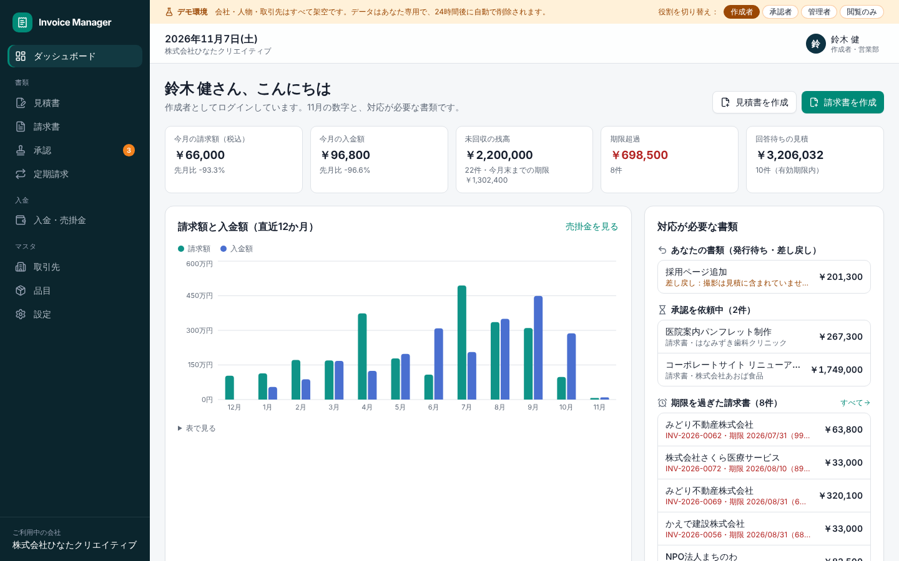
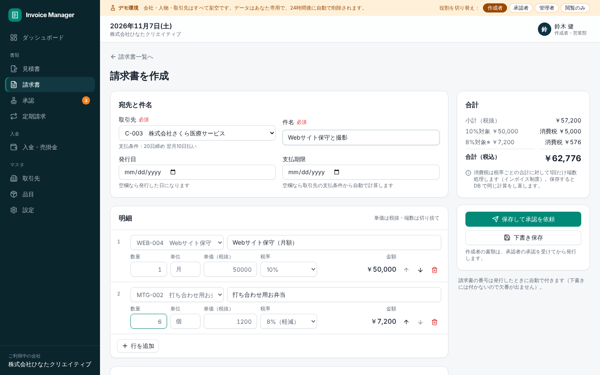
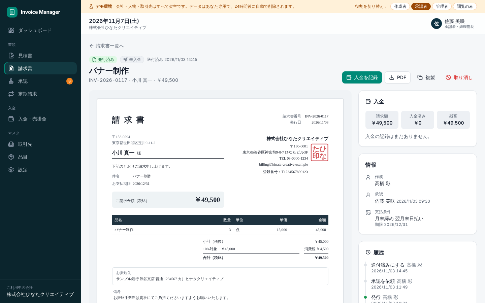
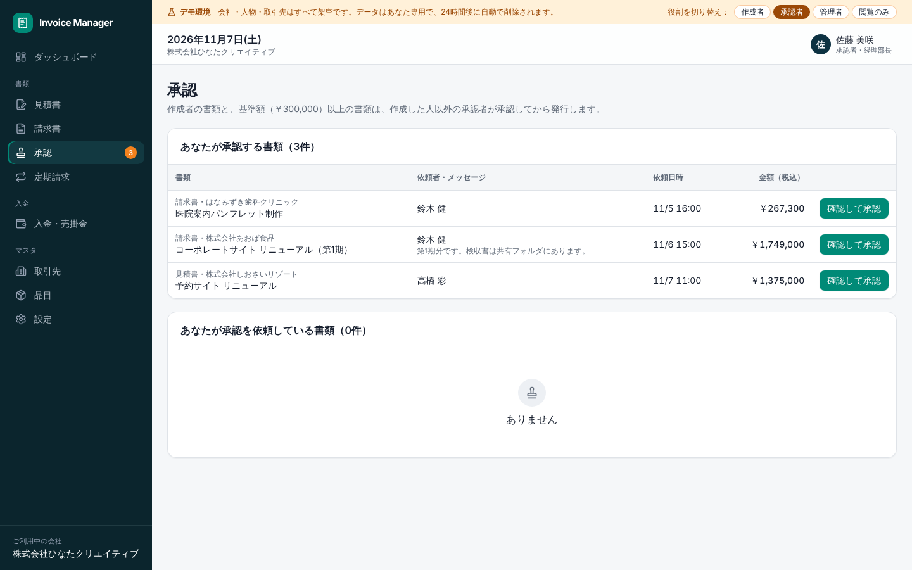
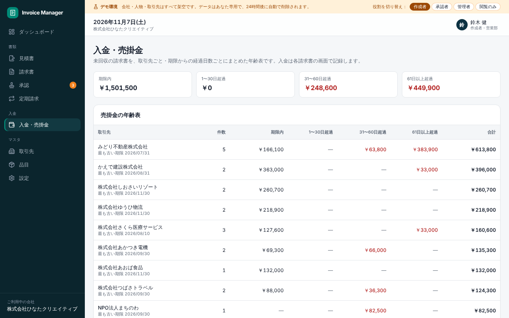
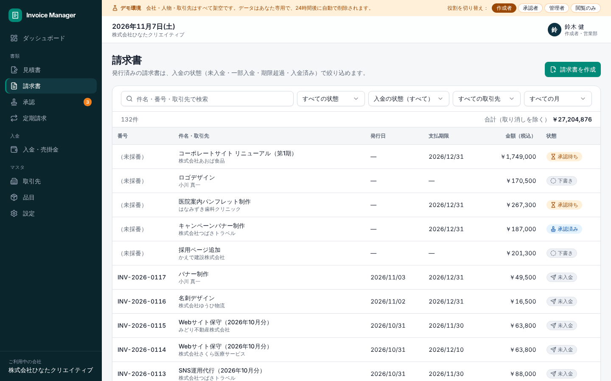
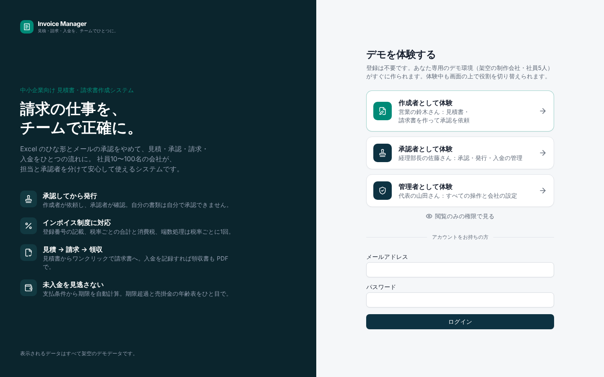

# Invoice Manager

**請求の仕事を、チームで正確に。**

社員10〜100名の会社向けの、見積書・請求書の作成システムです。Excel のひな形とメールでの承認をやめて、「見積 → 承認 → 請求 → 入金 → 領収書」をひとつの流れで管理します。担当者と承認者を分け、インボイス制度（適格請求書）の記載事項と消費税の計算に対応しています。



- ログイン画面の「作成者として体験」「承認者として体験」「管理者として体験」を押すと、**訪問者ごとに専用のデモ会社**（架空の制作会社・社員5人・書類 約200件）がその場で作られます。登録は不要です
- 体験中は画面上部の「役割を切り替え」で、同じ会社の別の社員として入り直せます（作成者が依頼 → 承認者が承認、を1人で試せます）
- 数字はすべて DB のデータから集計しています

## 画面

| 請求書の作成（明細・税率ごとの合計をその場で計算） | 請求書の詳細（A4 の見た目・入金・履歴） |
| --- | --- |
|  |  |
| **承認待ちの一覧** | **入金・売掛金（年齢表）** |
|  |  |
| **請求書の一覧（検索・入金状況）** | **ログイン（デモの入り口）** |
|  |  |

## 主な機能

- **見積書・請求書**：取引先と品目から明細を作成（値引きの行・軽減税率・対象外にも対応）。下書き保存、複製、見積書から請求書への変換（受注）
- **承認の流れ**：下書き → 承認依頼 → 承認／差し戻し（理由必須）→ 発行。自分で作成・編集した書類は自分で承認できない。作成者の書類は常に承認が必要で、承認者・管理者も基準額（既定 30万円）以上は別の承認者の承認が必要
- **発行**：発行したときに番号を付ける（`INV-2026-0001`。下書きには付けないので欠番が出ない）。宛先と自社の情報をその時点の内容で記録し、以後は変更できない。間違いは「取り消し」（理由必須・番号は欠番として残る）
- **インボイス制度**：登録番号、税率ごとの対象額と消費税、軽減税率の「※」。消費税の端数処理は税率ごとに1回（切り捨て・四捨五入・切り上げを会社ごとに選べる）
- **PDF**：請求書・見積書・領収書。会社名の文字から角印を描く。日本語フォント（IPAゴシック）は使う文字だけを埋め込む
- **入金**：分割入金、残高を超える入金や未来の日付は記録できない。入金ごとに領収書を発行（番号つき）
- **支払期限**：取引先の支払条件（20日締め翌月10日払い、月末締め翌月末払い など）から自動で計算
- **売掛金**：期限内・1〜30日・31〜60日・61日以上の年齢表、期限を過ぎた請求書の一覧
- **定期請求**：毎月・3か月ごとなどの請求書の下書きを、毎朝の定期処理で自動作成（承認の流れはふつうの書類と同じ）
- **ダッシュボード**：今月の請求額・入金額・未回収・期限超過、直近12か月の請求額と入金額、自分の対応が必要な書類
- **権限**：管理者・承認者・作成者・閲覧のみ。会社の設定と役割の変更は管理者だけ

## 技術スタック

| 分類 | 採用 |
| --- | --- |
| フレームワーク | Next.js 16（App Router・Server Actions）/ React 19 / TypeScript |
| UI | Tailwind CSS 4 / shadcn/ui（Radix UI）/ react-hook-form / zod / recharts / lucide-react / sonner |
| DB | PostgreSQL（公開環境は Neon を想定）/ postgres.js |
| PDF | pdf-lib / @pdf-lib/fontkit / IPAゴシック（IPA フォントライセンス。`assets/fonts`） |
| テスト | Vitest（単体・DB）/ Playwright（E2E・スマートフォン幅） |
| 公開 | Vercel（シンガポール・Neon と同じ地域）・Cron |

## 設計のポイント

- **業務のルールは DB に置く**：書類・明細・入金・採番の表には、アプリからも直接書き込めない（権限で禁止）。保存・承認・発行・入金はすべて `security definer` の DB 関数を通し、その中で役割・状態・版を確かめる。画面のボタンを隠すだけに頼らない
- **金額は DB が計算し直す**：画面のプレビュー（`src/lib/domain/tax.ts`）と DB（`app_private.recalc_document`）は同じ計算で、テストで一致を確かめている。保存された金額は常に DB の計算結果
- **会社ごとの分離**：すべての表に行レベルセキュリティ（RLS）。アプリはログイン中の利用者として DB に接続し直して読み書きする（`src/lib/db/rls.ts`）
- **同時編集**：書類に版番号を持たせ、古い画面から保存・発行しようとすると止めて「読み込み直す」を出す
- **ログイン**：セッションはアプリで管理（Cookie は HttpOnly・SameSite=Lax、DB にはトークンのハッシュだけを保存）。パスワードは scrypt
- **権限の一覧をテストで固定**：DB の権限を広げてしまったらテストが落ちる（`tests/db/privileges.test.ts`）

## ローカルで動かす

PostgreSQL 16 以上が必要です。

```bash
npm install
cp .env.example .env.local        # DATABASE_URL を自分の環境に合わせる
npm run db:local:reset            # DB を作り直してマイグレーション
npm run db:seed                   # 見本の会社を作る
npm run dev                       # http://localhost:3000
```

見本の会社には `admin@` / `approver@` / `member@` / `member2@` / `viewer@invoice.example` でログインできます（パスワードはローカルでは `demo-login-2026`、公開環境では `SEED_LOGIN_PASSWORD`）。

## テスト

```bash
npm run lint && npm run typecheck
npm test                          # 単体テスト＋DB テスト（ローカルの PostgreSQL を使う）
npm run test:e2e                  # ブラウザでの E2E（PC とスマートフォンの幅）
```

- 単体：消費税の計算（端数処理・値引き・税率の混在）、支払期限、入力の検証、デモデータの整合性
- DB：画面と DB の計算の一致、支払期限の SQL と TS の一致（675通り）、承認の流れ、職務の分離、版の競合、入金のルール、会社ごとの分離、権限の一覧
- E2E：作成 → 承認 → 発行 → 分割入金 → 領収書 → PDF、見積からの受注、閲覧のみの権限、ログインとログアウト、スマートフォンの幅

## デプロイ（Vercel + Neon）

1. Vercel でこのリポジトリを読み込み、Storage から Neon を接続する（`DATABASE_URL` が入る）
2. 環境変数 `SEED_LOGIN_PASSWORD`（12文字以上）と `CRON_SECRET`（16文字以上）を設定する
3. デプロイすると、ビルドの途中でマイグレーションと見本の会社の作成が自動で行われる（`scripts/deploy/vercel-build.ts`）
4. 毎朝6時（日本時間）に定期請求の作成と期限切れのデモの削除が動く（`vercel.json` の Cron）

## デモ環境の仕組み

- 「〜として体験」を押すと、架空の会社と社員5人・取引先16社・品目19件・書類 約200件を1回の処理で作り、選んだ役割の社員としてログインする
- 役割の切り替えは、同じデモ会社の別の社員としてセッションを作り直す（データは共有されるので、依頼と承認を続けて試せる）
- デモは24時間で自動削除。同時に存在できる数と、同じ接続元から1時間に作れる数に上限がある
